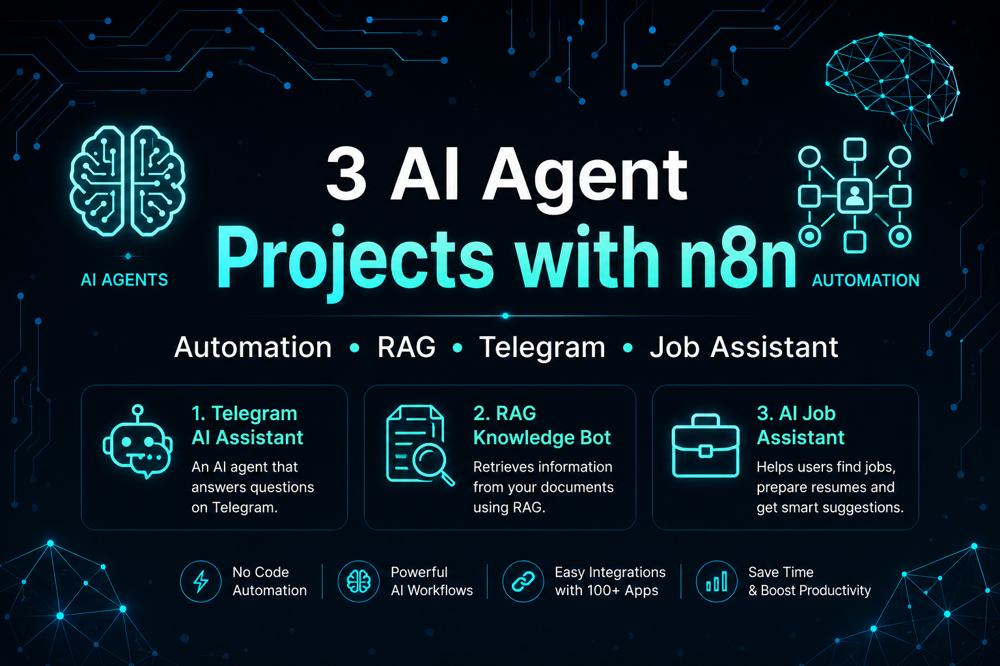
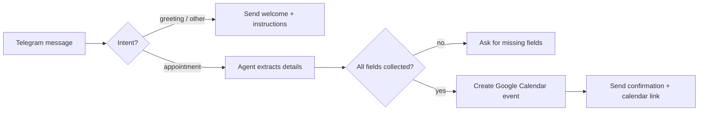
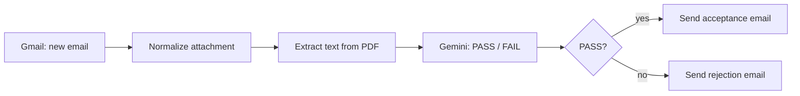
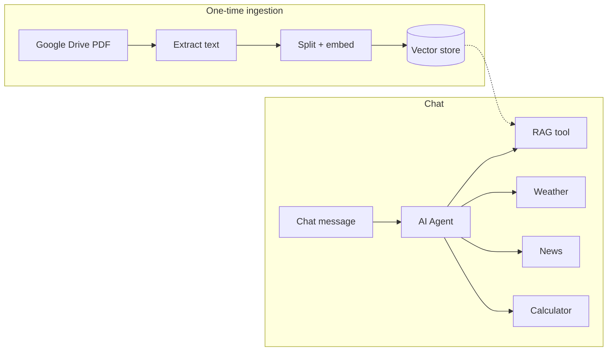

<div align="center">



# n8n AI Agent Projects

**Three AI-powered automation workflows built with [n8n](https://n8n.io): a Telegram appointment-booking bot, an AI resume screener, and a RAG chatbot for exam current affairs.**


</div>

---

## About

This repository is a portfolio of **no-code / low-code AI agent workflows** built in n8n. Each project is a ready-to-import `workflow.json` that combines Large Language Models (Google Gemini, OpenAI, MiniMax) with real-world integrations such as Telegram, Gmail, Google Calendar and Google Drive.

The projects demonstrate core AI-automation skills:

- **AI agents** with tools and conversation memory
- **Intent classification** and **structured (JSON) output parsing**
- **Retrieval-Augmented Generation (RAG)** with embeddings and a vector store
- **Event-driven automation** (Telegram, Gmail triggers)
- **Custom JavaScript Code nodes** for resilient data handling

## Projects

| # | Project | What it does | Key tech |
|---|---------|--------------|----------|
| 1 | [Telegram Appointment Booking Agent](projects/01-telegram-appointment-booking-agent) | Chat with a bot on Telegram to book a hospital appointment. The agent collects the missing details and creates a Google Calendar event. | Telegram, Gemini / OpenAI, Google Calendar |
| 2 | [AI Resume Screening Assistant](projects/02-ai-resume-screening-assistant) | Watches a Gmail inbox, reads PDF resumes, scores them with Gemini, and replies to each candidate automatically. | Gmail, Gemini, Code nodes |
| 3 | [Current Affairs RAG Chatbot](projects/03-current-affairs-rag-chatbot) | Chat agent that answers exam current-affairs questions from your own PDF, plus live weather, news and calculator tools. | Gemini, RAG, Vector Store, Google Drive |

### 1. Telegram Appointment Booking Agent



### 2. AI Resume Screening Assistant



### 3. Current Affairs RAG Chatbot



## Tech Stack

| Layer | Tools |
|-------|-------|
| Orchestration | [n8n](https://n8n.io) (cloud or self-hosted) |
| LLMs | Google Gemini 2.5 Flash / Gemini 3 Flash (preview), OpenAI `gpt-5-mini`, MiniMax |
| RAG | Google Gemini embeddings, in-memory vector store, recursive text splitter |
| Integrations | Telegram Bot API, Gmail, Google Calendar, Google Drive, OpenWeatherMap, NewsAPI |
| Scripting | JavaScript (n8n Code nodes), Python 3 (workflow validation script) |

## Repository Structure

```
n8n-ai-agent-projects/
├── README.md
├── LICENSE
├── .gitignore
├── requirements.txt
├── assets/
│   └── banner.png
├── projects/
│   ├── 01-telegram-appointment-booking-agent/
│   │   ├── README.md
│   │   ├── workflow.json                  # Gemini + MiniMax version
│   │   ├── workflow-openai-variant.json   # OpenAI + MiniMax version
│   │   └── screenshots/
│   ├── 02-ai-resume-screening-assistant/
│   │   ├── README.md
│   │   ├── workflow.json
│   │   └── screenshots/
│   └── 03-current-affairs-rag-chatbot/
│       ├── README.md
│       ├── workflow.json
│       ├── demo/rag-chatbot-demo.mp4
│       └── screenshots/
├── scripts/
│   └── validate_workflows.py              # JSON + secret-leak checker
└── .github/
    └── workflows/
        └── validate.yml                   # runs the checker on every push / PR
```

## Getting Started

### Prerequisites

- An **n8n** instance — [n8n Cloud](https://n8n.io) (free trial) or [self-hosted](https://docs.n8n.io/hosting/)
- Accounts/API keys for the services used by the project you want to try (see each project's README)
- *(Optional)* Python 3.9+ to run the validation script

### Import a workflow

1. Open your n8n instance and click **Workflows → Import from File**.
2. Select the `workflow.json` from the project folder you want.
3. Open each node that shows a credentials warning and **connect your own credentials**. Credentials are never stored in the exported JSON.
4. Replace any `YOUR_..._KEY_HERE` placeholders (for example the NewsAPI and OpenWeatherMap keys in project 3).
5. Run the workflow node-by-node to test, then toggle it **Active**.

### Validate the workflows (optional)

```bash
python scripts/validate_workflows.py
```

This checks that every workflow is valid JSON and scans for accidentally committed secrets (API keys, bot tokens, personal emails).

## Security Notes

- **Never commit real API keys, bot tokens or OAuth credentials.** Use n8n's credential manager instead of typing keys into node fields.
- Workflows here contain placeholders only. If you ever paste a real key into a node and export it, rotate that key.
- If you enable a public chat URL (project 3), anyone with the link can use your LLM quota. Disable it or add authentication when you are done testing.

## Roadmap

- [ ] Swap the in-memory vector store for a persistent one (Pinecone / Qdrant / Supabase)
- [ ] Add appointment cancellation and rescheduling to the Telegram bot
- [ ] Make resume-screening criteria configurable per job role
- [ ] Add human review before candidate emails are sent

## Author

**Ajim Mujawar**

- GitHub: [@ajimmujawar44]
- LinkedIn: [www.linkedin.com/in/ajim-mujawar-data-scientist]

## License

This project is licensed under the [MIT License](LICENSE).

---

<div align="center">If you find this useful, please consider giving the repo a ⭐</div>
