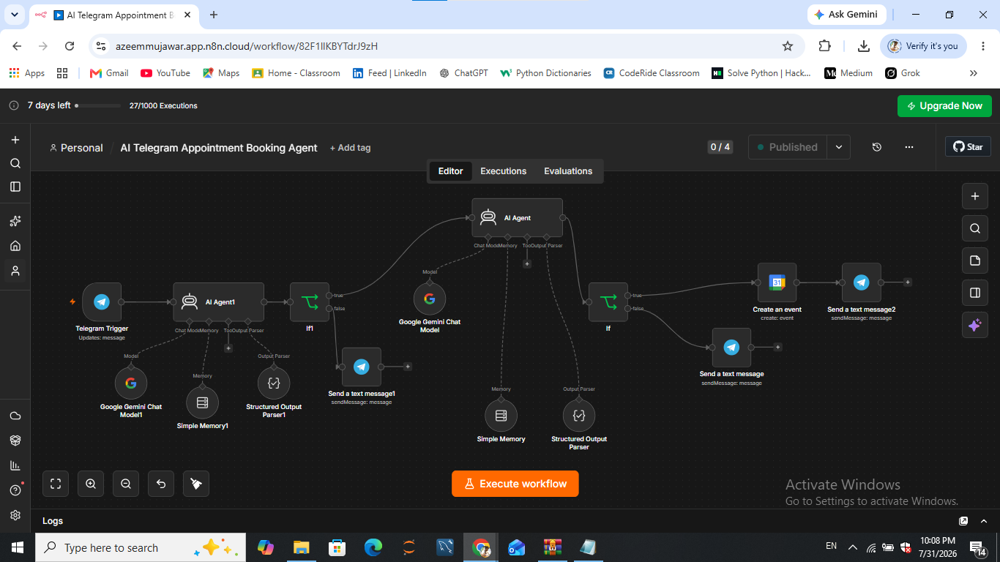
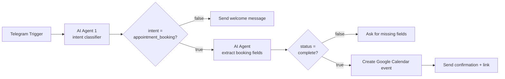

# 1. AI Telegram Appointment Booking Agent

A conversational **hospital appointment booking bot** for Telegram, built in n8n. Patients chat in natural language; an AI agent collects the required details across multiple messages, asks only for what is still missing, and then books the slot in **Google Calendar** and sends back a confirmation with the event link.



## What it does

1. Receives every message sent to the Telegram bot.
2. **Intent classifier agent** labels the message as `greeting`, `appointment_booking` or `other`.
3. Greetings and unrelated messages get a friendly welcome message that explains exactly what details to send (with an example).
4. Booking messages go to the **booking agent**, which extracts the fields below and uses **per-chat memory** so it never asks for something twice.
5. If anything required is missing, the bot lists exactly what is missing.
6. When everything is collected, a **1-hour Google Calendar event** is created (timezone `Asia/Kolkata`) and the bot replies with a confirmation and the calendar link.

| Field | Required | Format |
|-------|----------|--------|
| `patient_name` | Yes | text |
| `phone_number` | Yes | text |
| `appointment_date` | Yes | `DD-MM-YYYY` |
| `appointment_time` | Yes | `h:mm AM/PM` |
| `doctor_specialization` | No | e.g. General Physician, Cardiologist |

## Architecture



Both agents use a **Structured Output Parser** so the LLM must return valid JSON, and a **Simple Memory** node (window of 10 messages) keyed by the Telegram chat ID.

## Files

| File | Description |
|------|-------------|
| `workflow.json` | Main version: **MiniMax** (intent) + **Gemini 2.5 Flash** (booking agent) |
| `workflow-openai-variant.json` | Alternative: **MiniMax** (intent) + **OpenAI `gpt-5-mini`** (booking agent) |
| `screenshots/` | n8n canvas screenshots of each version |

> You can swap any chat-model node for the provider you prefer. n8n lets you replace it without changing the rest of the flow.

## Setup

1. Create a bot with [@BotFather](https://t.me/BotFather) on Telegram and copy the bot token.
2. In n8n, import `workflow.json` (**Workflows → Import from File**).
3. Create and connect these credentials:
   - **Telegram API** — your bot token (Trigger + 3 Send nodes)
   - **Google Calendar OAuth2** — the calendar that will receive the bookings
   - **Google Gemini (PaLM) API** — for the booking agent (or OpenAI if you use the variant)
   - **MiniMax API** — for the intent classifier (or swap in any other chat model)
4. In the **Create an event** node, select your own calendar (the file ships with the placeholder `your-calendar@gmail.com`).
5. Adjust the timezone in the **Create an event** expressions if you are not in `Asia/Kolkata`.
6. Message your bot, check each node's output, then toggle the workflow **Active**.

## Example conversation (illustrative)

```
You:  Hi
Bot:  🏥 Hospital Appointment Booking Assistant ... (shows the details to send)

You:  I'm Kumar, +91 9876543210. Book me on 22-07-2026
Bot:  Please provide the following details:
      • appointment_time

You:  9:00 AM, cardiologist
Bot:  ✅ Appointment Booked Successfully! ... 📌 Calendar Event: <link>
```

## Notes and limitations

- Appointments are created as 1-hour events; there is no double-booking check yet.
- The date must be in `DD-MM-YYYY` and the time must include AM/PM — the parsing in the Calendar node depends on it.
- Patient names and phone numbers end up in the calendar event description. Only use real patient data if your setup meets the privacy rules that apply to you.
