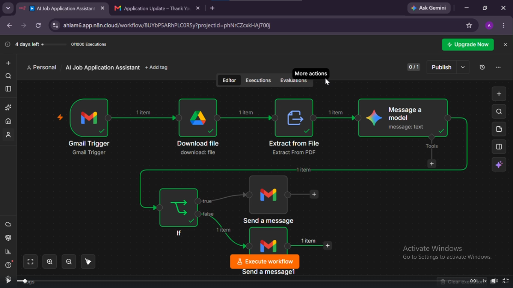
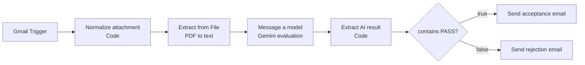

# 2. AI Resume Screening Assistant

An automated recruitment workflow built in n8n. It watches a Gmail inbox for job applications, reads the attached PDF resume, asks **Google Gemini** to evaluate it against defined job criteria, and automatically replies to each applicant with an acceptance or rejection email.

> The screenshot is an early version of the workflow that downloaded the attachment through Google Drive. The final `workflow.json` reads the attachment straight from Gmail and adds two Code nodes for reliability.

## What it does

1. **Gmail Trigger** polls the inbox every minute for new emails and downloads their attachments.
2. **Normalize attachment** (Code node) finds the binary field that holds the attachment, whatever it is named, and extracts a clean sender email address from the raw Gmail headers.
3. **Extract from File** pulls the text out of the PDF resume.
4. **Message a model** (Gemini) evaluates the resume. The default prompt screens for a *Software Engineer* role: at least 2 years of relevant experience, a Computer Science (or related) degree, and experience with at least one modern programming language. It must answer `PASS` or `FAIL` on the first line plus a one-sentence reason.
5. **Extract AI result** (Code node) pulls plain text out of Gemini's response, whatever its nested shape.
6. **If** the result contains `PASS`, send the acceptance email; otherwise send the rejection email.

## Architecture

## Setup

1. Import `workflow.json` into n8n (**Workflows → Import from File**).
2. Connect credentials:
   - **Gmail OAuth2** — used by the trigger and both send nodes
   - **Google Gemini (PaLM) API** — used by the evaluation node
3. Edit the prompt in **Message a model** so it matches your real job title and hiring criteria.
4. Edit the **Send a message** and **Send a message1** templates to match your organisation's tone and branding.
5. Email yourself a test message with a PDF resume attached and step through each node.
6. Toggle the workflow **Active**.

## Notes and limitations

- The Gmail Trigger needs both `simple: false` and `downloadAttachments: true`. Without them no attachment data is delivered. This is already set in the workflow.
- The Gmail Trigger picks up **every** new email. An email with no attachment makes **Normalize attachment** throw an error, so that run fails and no reply is sent. The node prefers a `.pdf` attachment and falls back to the first attachment it finds. Add a filter on the Gmail Trigger (for example a label or subject keyword) before using this on a busy inbox.
- The PASS check uses "contains `PASS`". If you want stricter matching, change the **If** node to "starts with".
- The acceptance email includes the AI's one-line assessment. Remove that line from the template if you do not want candidates to see it.
- The free Gemini API tier has rate limits. Enable billing for high application volume.

## Responsible use

Automated screening can be wrong or biased. Treat the AI verdict as a first-pass filter, keep a human in the loop before sending final rejections, and make sure you comply with the hiring and data-protection rules that apply where you operate.
