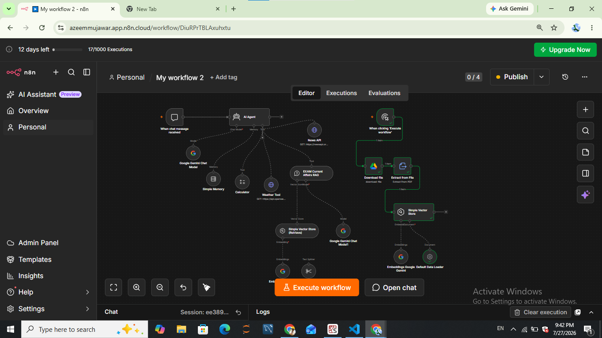
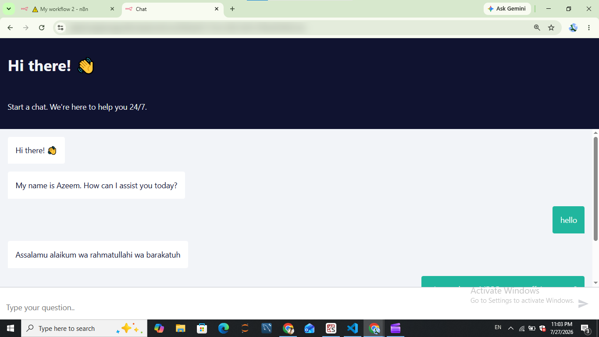
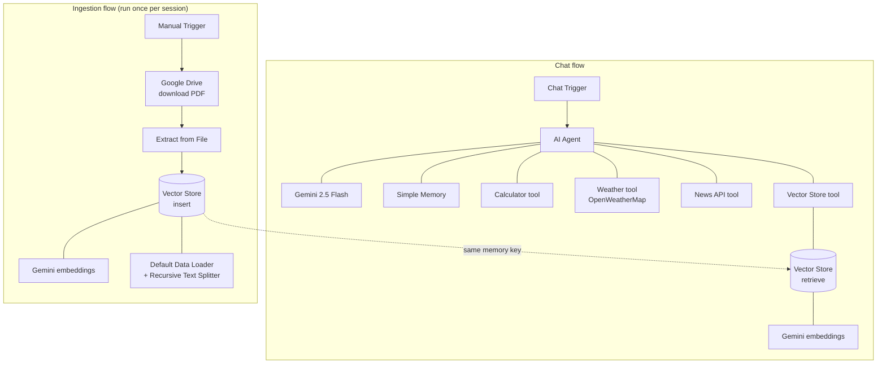

# 3. AI Current Affairs RAG Chatbot

A conversational AI agent built in n8n that answers **competitive-exam current-affairs questions** using **Retrieval-Augmented Generation (RAG)** over your own PDF notes. The same agent can also look up live weather and news and do maths, all from one chat window.

## Demo

| Chat UI | Video |
|---------|-------|
|  | [`demo/rag-chatbot-demo.mp4`](demo/rag-chatbot-demo.mp4) (about 2 minutes) |

## What it does

- **Ingests** a PDF of current-affairs notes from Google Drive into an in-memory vector store.
- **Answers questions** by retrieving the most relevant chunks and passing them to Google Gemini.
- **Uses tools** from a single AI Agent: Calculator, Weather (OpenWeatherMap), News (NewsAPI) and the RAG knowledge base.
- **Remembers** the conversation within a chat session (Simple Memory).
- Is available through n8n's built-in **hosted chat** page.

## Architecture

Two vector-store nodes share one in-memory key (`vector_store_key`): one in **insert** mode for ingestion and one in **retrieve** mode for the agent's RAG tool. This is required because a single vector-store node can only run in one mode.

## Setup

1. Import `workflow.json` into n8n (**Workflows → Import from File**).
2. Connect credentials:
   - **Google Gemini (PaLM) API** — chat model and embeddings
   - **Google Drive OAuth2** — to download the source PDF
3. Add your own API keys in the two HTTP Request tool nodes:
   - **News API** — replace `YOUR_NEWSAPI_KEY_HERE` (free key at [newsapi.org](https://newsapi.org))
   - **Weather Tool** — replace `YOUR_OPENWEATHERMAP_KEY_HERE` (free key at [openweathermap.org](https://openweathermap.org/api))
4. Upload your own current-affairs PDF to Google Drive and update the file ID in the **Download file** node.
5. Click **Execute workflow** on the manual trigger once to fill the vector store.
6. Open the **Chat** panel (or the hosted chat URL) and start asking questions.

## Customising the assistant

The agent's behaviour is controlled by the **system message** on the **AI Agent** node. The shipped message asks for short, polite answers, says "I don't know" instead of guessing, and greets users with an Islamic greeting. Edit it to change the tone, language or greeting.

## Notes and limitations

- The vector store is **in-memory**: data is lost whenever n8n restarts, so re-run the ingestion flow each session. For production, switch to a persistent store such as Pinecone, Qdrant or Supabase.
- The free Gemini tier has rate limits, which large PDFs can hit during embedding. Enable billing for smoother runs.
- If you turn on **Make Chat Publicly Available**, anyone with the link can use your Gemini quota. Turn it off or add authentication when you are not demoing.
- The demo video shows the hosted chat URL from the original author's instance. That instance is not part of this repository; deploy your own.
